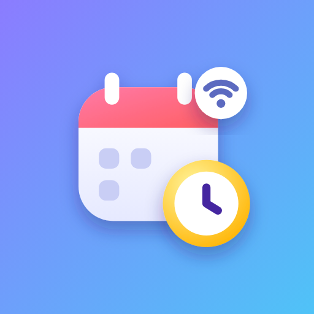
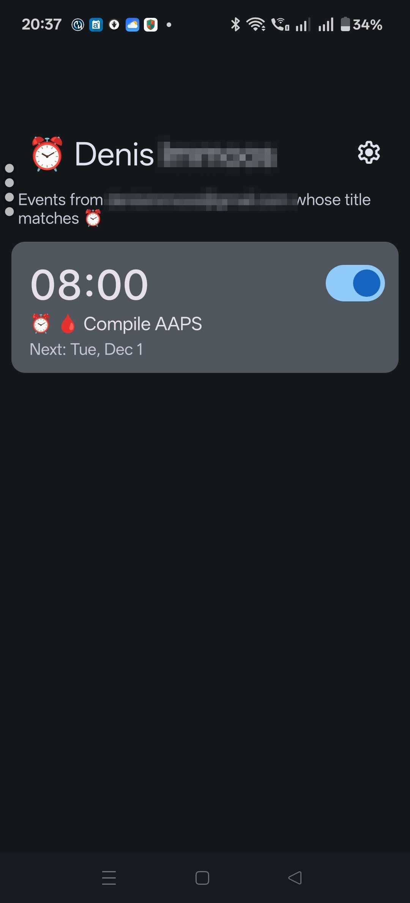
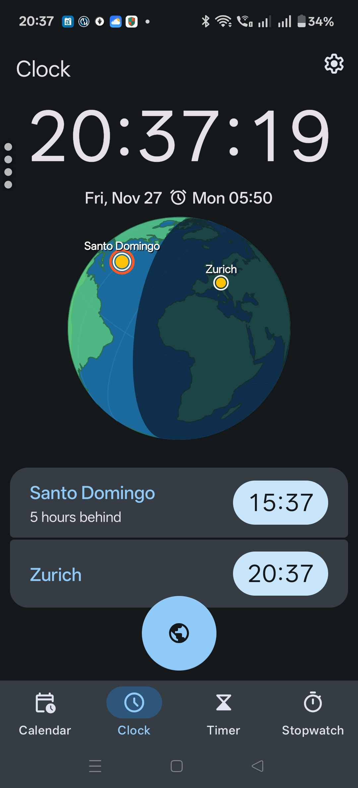

<!--suppress CheckImageSize -->
#  Mighty Calendar Alarm

**Mighty Calendar Alarm** turns events in your Google Calendar into real, fullscreen alarms.
You decide which events ring with profiles: each profile watches one calendar and rings for
every event whose title matches its pattern, for example every event that starts with ⏰.
Clock, Timer and Stopwatch are included. The app has no internet permission.

It is a fork of [Clock](https://github.com/BlackyHawky/Clock) by BlackyHawky, which is based on AOSP Clock.

# 📅 Calendar alarms

### How it works
1. Open the **Calendar** tab and tap **+** to create a profile (or long-press the app icon and pick **Create new profile**).
2. Pick a calendar and enter a title filter, for example `⏰` or `^Alarm:`.
3. Every matching event in the next 7 to 30 days gets an alarm. The app checks your calendar every 15 minutes and after every change.
4. Tap a profile to see its upcoming alarms and switch single alarms off.

When an alarm rings you get a big **Dismiss** button and three snooze buttons (by default 5, 10 and 20 minutes), on the alarm screen and in the notification.

### What a profile can do
* Several profiles, each with its own calendar, title filter, sound and behaviour
* The same calendar can be used by several profiles with different filters
* Skip events you declined or answered "maybe" to, optionally ring for all-day events
* Ring before the event starts, and optionally again when it ends
* Three snooze lengths, optional extending of the event in the calendar when you snooze
* Optional Wi‑Fi condition: ring only near a chosen network
* Volume as a share of the app's alarm volume, vibration, flashlight and escalation
* Shows title, description and place on the lock screen (can be switched off)

### Calendar tab
All your profiles at a glance. Each card shows the profile name, how many alarms it has in the next days, the next alarm, and which calendar and title filter it uses. The switch turns a profile on or off, the gear opens its settings, and **+** creates a new profile.

### Upcoming alarms of a profile
Tapping a profile lists every event that will ring, with time, title and date. Each alarm can be switched off on its own, for example to skip one day.

### A profile with a single alarm
Another profile with one matching event in the next days. The line at the top says which calendar is checked and which title filter is used.

### All profile options
The whole profile editor from top to bottom: name and calendar, title filter and look-ahead, which events ring, timing, the Wi‑Fi condition, sound and vibration, maximum ring time, the three snooze lengths and the lock screen.

# 🌍 Clock

* Big digital or analog clock with the next alarm
* World clock with a rotatable globe, local time and cities around the world

### Clock tab
The current time with the next alarm, a rotatable globe showing day and night, and the time in your chosen cities.

# ⏱️ Timer and stopwatch

* Timer with keypad, several named stopwatches

### Timer tab
A simple timer: type the duration on the keypad and start it. Next to it are the Calendar, Clock and Stopwatch tabs.

# ⚙️ More

* Backup and restore of profiles and settings, optionally on a schedule (older backups still import)
* App shortcuts: Create new profile, New timer, Start stopwatch
* Widgets that show the next calendar alarm, quick settings tiles
* Light, dark or system theme, AMOLED mode, accent colors (Blue by default)
* English and German

# 📥 Install

There are no store builds yet. Build the app from this branch with Android Studio, or install an APK built from it.

Application ID: `redpantyhose.claude.mightycalendaralarm` (debug builds add `.debug`). The app installs side by side with the original Clock app.

The app needs access to your calendar. For the Wi‑Fi condition it also needs location access, which Android requires to see Wi‑Fi networks; no location data is collected or sent.

# 🐞 Common issues

* Disable battery optimization for the app, otherwise some phones delay the calendar check or the alarm.
* On Android 14 and newer some phones (for example with HyperOS) revoke the "Full screen notification" permission. Allow it again in the app's permission settings.

# 📜 License

Mighty Calendar Alarm is licensed under the **GNU General Public License v3.0**. Any modified version must be released under the same license with its full source code.
See [LICENSE](LICENSE). As it is based on **AOSP Clock**, which uses the Apache License 2.0, the [Apache 2.0](LICENSE-Apache-2.0) license file is included too.

# 🏅 Credits
* [Clock](https://github.com/BlackyHawky/Clock) by BlackyHawky and its contributors, the base of this app
* Code references from [LineageOS](https://github.com/LineageOS/android_packages_apps_DeskClock) and [crDroid](https://github.com/crdroidandroid/android_packages_apps_DeskClock)
* Translations of the original app by the community via [Weblate](https://translate.codeberg.org/projects/clock/)
