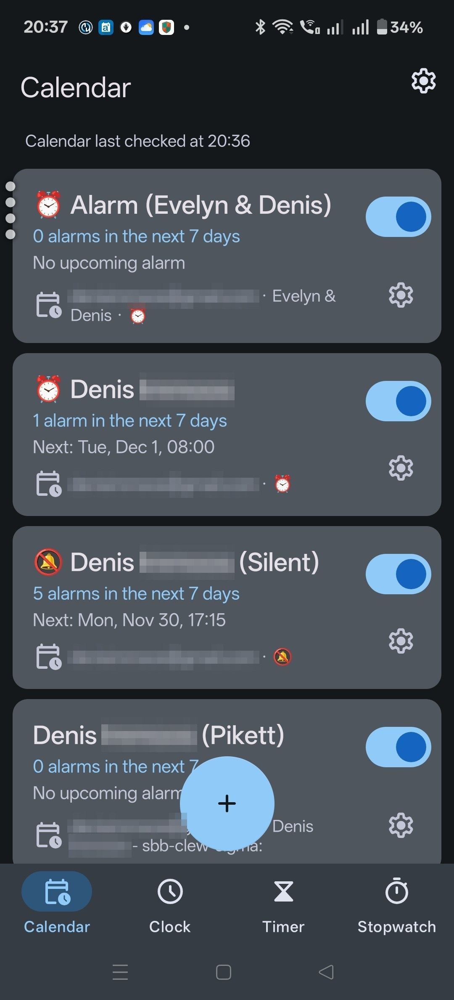
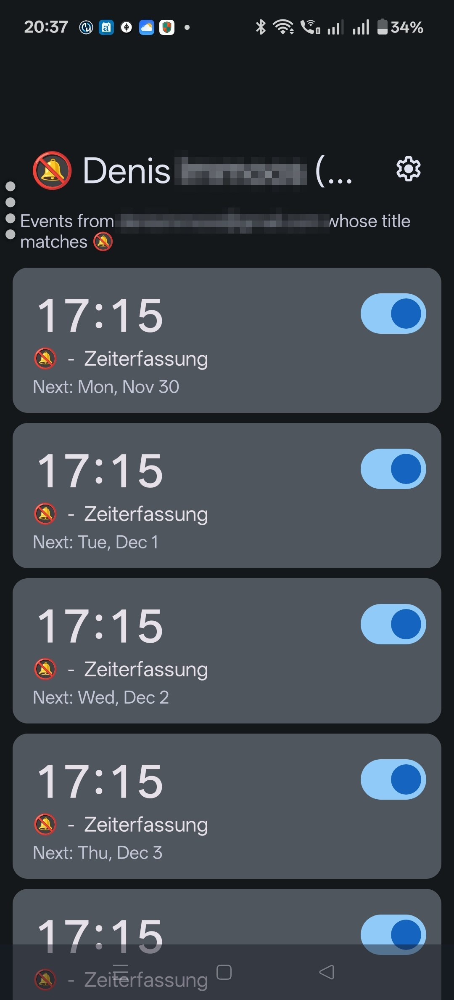
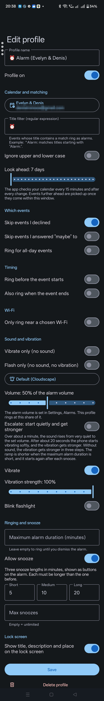
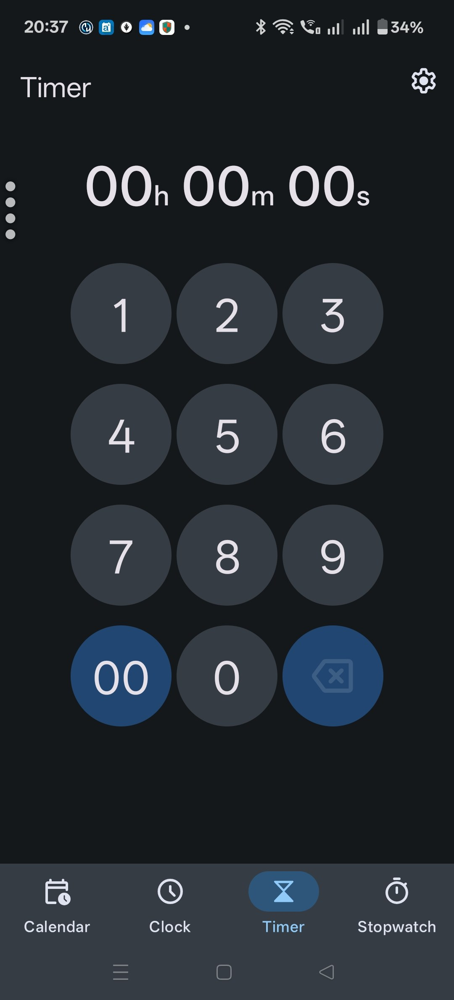

<!--suppress CheckImageSize -->
#  Mighty Calendar Alarms

**Mighty Calendar Alarms** turns events in your Google Calendar into real, fullscreen alarms.
You decide which events ring with profiles: each profile watches one calendar and rings for
every event whose title matches its pattern, for example every event that starts with ⏰.
Clock, Timer and Stopwatch are included. The app has no internet permission.

It is a fork of [mighty-alarm-clock](https://github.com/RapidAppCoder/mighty-alarm-clock) (AlarmClock Deluxe by HutterSoft), which itself is a fork of [Clock](https://github.com/BlackyHawky/Clock) by BlackyHawky, based on AOSP Clock.

# 📅 Calendar alarms

### How it works
1. Open the **Calendar** tab and tap **+** to create a profile (or long-press the app icon and pick **Create new profile**).
2. Pick a calendar and enter a title filter, for example `⏰` or `^Alarm:` (see [the title filter](#the-title-filter-regular-expressions) for more).
3. Every matching event in the next 7 to 30 days gets an alarm. The app checks your calendar every 15 minutes and after every change.
4. Tap a profile to see its upcoming alarms and switch single alarms off.

When an alarm rings you get a big **Dismiss** button and three snooze buttons (by default 5, 10 and 20 minutes), on the alarm screen and in the notification.

### What a profile can do
* Several profiles, each with its own calendar, title filter, sound and behaviour
* The same calendar can be used by several profiles with different filters
* Skip events you declined or answered "maybe" to, optionally ring for all-day events
* Ring before the event starts, and optionally again when it ends
* Three snooze lengths, optional extending of the event in the calendar when you snooze
* Optional Wi‑Fi condition: ring only near a chosen network
* Volume as a share of the app's alarm volume, vibration, flashlight and escalation
* Shows title, description and place on the lock screen (can be switched off)

### The title filter (regular expressions)
The title filter is a [regular expression](https://developer.android.com/reference/java/util/regex/Pattern), so it can be as simple or as precise as you like.
It matches **anywhere in the event title**, unless you anchor it with `^` (start) or `$` (end).
Switch on **Ignore upper and lower case** in the profile to treat `alarm`, `Alarm` and `ALARM` the same, or put `(?i)` at the start of the filter.
An invalid filter is shown as an error in the editor and never rings.

| Filter | Rings for events whose title … | Example that rings |
|---|---|---|
| `⏰` | contains the ⏰ emoji anywhere | `Dentist ⏰` |
| `^Alarm:` | starts with "Alarm:" | `Alarm: Flight to Rome` |
| `⏰\|Alarm:\|Wecker` | contains any of the three | `Wecker Sport` |
| `^Train` | starts with "Train" | `Train to Bern 07:12` |
| `(?i)^dentist` | starts with "dentist" in any case | `DENTIST check-up` |
| `\bgym\b` | contains "gym" as a whole word (not "gymnastics") | `Morning gym` |
| `^(?!.*Cancelled).*Meeting` | contains "Meeting" but not "Cancelled" | `Team Meeting` |
| `Shift (Early\|Late)$` | ends with "Shift Early" or "Shift Late" | `Hospital Shift Late` |
| `\b\d{1,2}:\d{2}\b` | contains a time like 7:30 or 14:05 | `Pickup 7:30` |
| `\b[A-Z]{2}\d{3,4}\b` | contains a code like a flight number | `Flight LX1612` |

Each profile has its own filter, so you can use several profiles with different filters, sounds and settings on the same calendar.

### Calendar tab
All your profiles at a glance. Each card shows the profile name, how many alarms it has in the next days, the next alarm, and which calendar and title filter it uses. The switch turns a profile on or off, the gear opens its settings, and **+** creates a new profile.

### Upcoming alarms of a profile
Tapping a profile lists every event that will ring, with time, title and date. Each alarm can be switched off on its own, for example to skip one day.

### All profile options
The whole profile editor from top to bottom: name and calendar, title filter and look-ahead, which events ring, timing, the Wi‑Fi condition, sound and vibration, maximum ring time, the three snooze lengths and the lock screen.

# 🌍 Clock

* Big digital or analog clock with the next alarm
* World clock with a rotatable globe, local time and cities around the world

### Clock tab
The current time with the next alarm, a rotatable globe showing day and night, and the time in your chosen cities.

# ⏱️ Timer and stopwatch

* Timer with keypad, several named stopwatches

### Timer tab
A simple timer: type the duration on the keypad and start it. Next to it are the Calendar, Clock and Stopwatch tabs.

# ⚙️ More

* Backup and restore of profiles and settings, optionally on a schedule (older backups still import)
* App shortcuts: Create new profile, New timer, Start stopwatch
* Widgets that show the next calendar alarm, quick settings tiles
* Light, dark or system theme, AMOLED mode, accent colors (Blue by default)
* English and German

# 🔒 Privacy and permissions

**The app has no internet permission.** It never connects to Google or any other server.

It reads the calendars that are stored on your phone, through Android's calendar storage (the
same one your calendar apps use). Your Google account keeps that storage in sync with Google
Calendar, which is done by Android itself, not by this app. To pick up changes to shared
calendars sooner, the app only asks Android to sync (when you open the Calendar tab or a
profile, and about once an hour).

| Permission | What it is used for |
| --- | --- |
| Calendar (read) | Find the events that match your profiles. Required for calendar alarms. |
| Calendar (write) | Only for **Snoozing the end alarm extends the event**: the app moves the end of that one event. Asked for only when you switch the option on. |
| Location, "Allow all the time" | Only for the **Wi‑Fi condition**. Android shows Wi‑Fi names and MAC addresses only to apps with location access, and the check runs just before an alarm rings, in the background. No location is read or stored. |
| Notifications, full screen, alarms, battery | Show the alarm on time, also on the lock screen. |

All of them can be checked and changed under **Settings > Permissions management** in the app. The location
entry appears there once a profile uses the Wi‑Fi condition.

# 📥 Install

There are no store builds yet. Build the app from this branch with Android Studio, or install an APK built from it.

Application ID: `redpantyhose.claude.mightycalendaralarm` (debug builds add `.debug`). The app installs side by side with the original Clock app.

See [Privacy and permissions](#-privacy-and-permissions) for what the app asks for.

# 🐞 Common issues

* Disable battery optimization for the app, otherwise some phones delay the calendar check or the alarm.
* On Android 14 and newer some phones (for example with HyperOS) revoke the "Full screen notification" permission. Allow it again in the app's permission settings.

# 📜 License

Mighty Calendar Alarms is licensed under the **GNU General Public License v3.0**. Any modified version must be released under the same license with its full source code.
See [LICENSE](LICENSE). As it is based on **AOSP Clock**, which uses the Apache License 2.0, the [Apache 2.0](LICENSE-Apache-2.0) license file is included too.

# 🏅 Credits
* [mighty-alarm-clock](https://github.com/RapidAppCoder/mighty-alarm-clock) (AlarmClock Deluxe) by HutterSoft, the direct base of this app
* [Clock](https://github.com/BlackyHawky/Clock) by BlackyHawky and its contributors, the base of AlarmClock Deluxe
* Code references from [LineageOS](https://github.com/LineageOS/android_packages_apps_DeskClock) and [crDroid](https://github.com/crdroidandroid/android_packages_apps_DeskClock)
* Translations of the original app by the community via [Weblate](https://translate.codeberg.org/projects/clock/)
